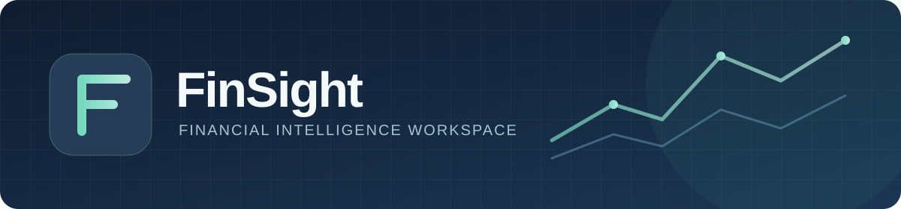
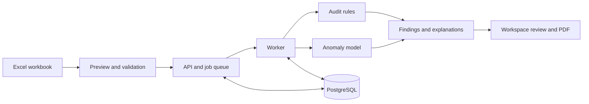

  

  
<strong>From financial workbook to explainable audit findings.</strong>

  

    
    
    
    
  

FinSight helps a team upload financial statements, review the extracted values,
run audit rules and anomaly detection, and investigate results together. It
shows the evidence and data coverage behind each finding so reviewers can make
their own judgment. **An anomaly score is a signal for review, not a fraud
probability or an audit opinion.**

## Live deployment

**Status:** Live on Azure Container Apps  
**Application:** [Open FinSight](https://finsight-web.mangograss-4056ef91.eastasia.azurecontainerapps.io)

The hosted deployment uses Azure Container Apps for the web app, API, and
analysis worker, with managed PostgreSQL and durable Azure Blob Storage for
application data and generated reports.

## What it does

| Step | In FinSight |
| --- | --- |
| **Preview** | Validate an Excel workbook before analysis, including reporting years, units, missing metrics, and source cells. |
| **Analyze** | Run financial audit rules and a saved Isolation Forest model; show skipped checks and filled model inputs. |
| **Explain** | Explore rule findings and SHAP feature contributions, with coverage and limitations alongside the scores. |
| **Review** | Assign findings, add notes, record decisions, and keep an audit trail in a shared workspace. |
| **Report** | Download the generated PDF while preserving the original analysis evidence. |

## How it fits together

The React frontend talks to a FastAPI backend. A separate worker processes
uploads, while PostgreSQL stores accounts, jobs, and review history. Saved
analysis files need persistent storage shared by the API and worker.

## Run locally

You need Python 3.13, Node.js, and PostgreSQL. The backend dependency list
supports Python 3.11+, but 3.13 is the version used for the local workflow.

1. Install backend packages: `python -m pip install -r backend/requirements.txt`.
2. Copy `backend/.env.example` to `backend/.env`. Set `DATABASE_URL` for your
   PostgreSQL database and replace `SECRET_KEY` with a random value.
3. In `frontend/`, run `npm ci`.
4. On Windows, run `./start-local.ps1` from the project root. The script starts
   the API, worker, and frontend. Open <http://127.0.0.1:5173/app>.

For a teammate cloning this repository, the source code, saved ML model,
`client_data.xlsx`, workbook template, dependency manifests, and deployment files
are included. Install Python and Node dependencies using the commands above;
installed packages and build output are generated on each machine. PostgreSQL
and its data are separate from Git. Create a fresh database for a new deployment,
or transfer a coordinated PostgreSQL backup and matching analysis storage if
existing accounts, uploads, and reviews must be preserved. Generate new `.env`
files from the examples and keep credentials private. The
[deployment guide](docs/ORACLE_FREE_DEPLOYMENT.md) starts with a fresh database.

The [full workflow](WORKFLOW.md) includes manual startup commands and explains
the upload, scoring, review, and reporting behavior. The blank workbook template
is at [`frontend/public/data/FinSight_Template.xlsx`](frontend/public/data/FinSight_Template.xlsx).

## Project map

| Path | Purpose |
| --- | --- |
| [`frontend/`](frontend/) | React interface and client tests |
| [`backend/`](backend/) | FastAPI app, worker, ML artifacts, and backend tests |
| [`deploy/`](deploy/) and [`compose.yaml`](compose.yaml) | Container images and deployment configuration |
| [`docs/`](docs/) | Deployment and implementation notes |

## Check and deploy

Run `python -m unittest discover -s tests -v` from `backend/` and `npm run build`
from `frontend/`. The repository includes `client_data.xlsx` in the project root
for sample analysis and backend tests. See the [backend test notes](backend/tests/README.md).

Start with the [deployment guide](docs/ORACLE_FREE_DEPLOYMENT.md) for the
container setup. Production needs HTTPS, a persistent database and artifact
volume, backups, and secrets set on the host. Keep `.env` files, uploaded
workbooks, logs, and generated reports out of the repository.
